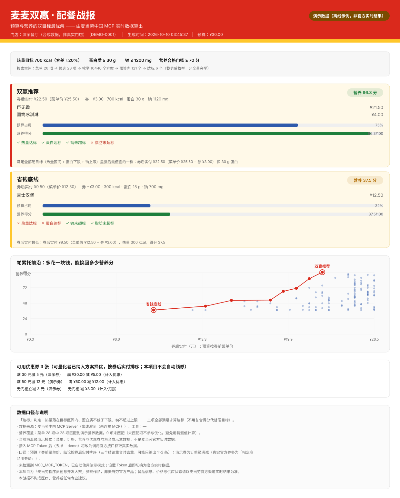

<div align="center">

# 麦麦双赢 · M-Dual Planner

**输入一个预算和一组营养目标，用麦当劳中国官方 MCP 的数据，算出「花得最少、吃得最对」的那一餐。**

省钱和营养不是两件事——它是同一个约束优化问题的两个目标。


</div>

---

## 目录

- [这是什么](#这是什么)
- [效果预览](#效果预览)
- [它到底算了什么](#它到底算了什么)
- [快速开始](#快速开始)
- [使用示例](#使用示例)
- [在线网页演示](#在线网页演示)
- [目标用户](#目标用户)
- [用到了哪些麦当劳 MCP 工具](#用到了哪些麦当劳-mcp-工具)
- [工程实践](#工程实践)
- [已知限制与未验证项](#已知限制与未验证项)
- [项目结构](#项目结构)
- [参赛信息](#参赛信息)

---

## 这是什么

多数「麦当劳点餐助手」回答的是**有什么**（有哪些券、有哪些活动、这个多少卡）。
麦麦双赢回答的是**该选哪个**，而且是带约束的：

> 「我这一餐最多花 30 块，想要 700 大卡上下、至少 30 g 蛋白质、钠别超过 1200 mg。给我一个方案。」

这本质是一个**多目标组合优化**问题：从门店真实菜单里选组合，让实付金额尽可能低、
让营养达标度尽可能高，同时满足品类规则与硬性营养边界。麦麦双赢把它做成了可复现的三步：

1. **取真数**：调用麦当劳中国 MCP 拿门店、菜单、官方营养库、优惠券、官方算价；
2. **求最优**：本地做约束求解，输出帕累托前沿和三个可执行结论；
3. **出结论**：生成一张可分享的 SVG 战报，每个数字都能追溯到来源。

## 效果预览



> ⚠️ 上图由 `node bin/mcd-dual.mjs plan --demo` 生成，使用的是**内置合成演示数据**，
> 用于在没有 MCP Token 的环境下展示算法与出图流程，**不是**任何真实门店的实时菜单或价格。
> 战报页眉的模式徽标会明确区分「演示数据」与「实时数据（官方 MCP）」。

最多给出三个结论，分别回答三个不同的问题（三者重合时会去重，因此可能只输出 1~2 条）：

| 结论 | 回答的问题 | 适用场景 |
|---|---|---|
| **双赢推荐** | 满足你设的**全部硬目标**（热量区间 + 蛋白下限 + 钠上限）的方案里，最便宜的是哪个？ | 「我要达标，但不想多花钱」 |
| **营养上限** | 预算之内，营养最好能到什么程度？ | 「我想看看这 30 块的天花板」 |
| **省钱底线** | 绝对最便宜能多少钱吃饱？ | 「今天只想省钱」 |

## 它到底算了什么

以 30 元预算、700 kcal ±20%、蛋白质 ≥30 g、钠 ≤1200 mg 为例，演示数据下引擎枚举了
10,440 个组合，其中 121 个落在预算内、6 个满足全部硬目标，帕累托前沿有 8 个非支配解。

- **决策变量**：默认 1 主食 + 0~2 小食 + 0~1 饮料 + 0~1 甜品（规则可在 `src/solver.mjs` 里改）。
- **营养得分**：`100 ×(0.40×热量贴合 + 0.45×蛋白达成 + 0.15×脂肪控制) − 钠超标惩罚`，夹在 0~100。
- **不猜数**：匹配不到官方营养数据的餐品会被**排除在优化之外**并在战报里写明数量，
  而不是拿一个近似的数字硬算。单位歧义（kJ/kcal、g/mg）会自动换算，但**标注为推断值**。

更细的模型说明见 [docs/SOLVER.md](docs/SOLVER.md)。

## 快速开始

**零依赖**：不需要 `npm install`，只要有 Node.js 20+ 就能跑。

```bash
git clone https://github.com/<你的账号>/mcd-dual-planner.git
cd mcd-dual-planner

# 1) 离线体验：用内置合成数据跑通全流程并生成战报（无需 Token）
node bin/mcd-dual.mjs plan --demo --budget 30

# 2) 打开生成的战报
#    reports/report.svg  —— 用浏览器打开即可
```

接入真实数据（推荐先跑自检）：

```bash
# 申请 Token：https://open.mcd.cn/mcp → 右上角登录 → 控制台 → 激活 → 复制

# PowerShell
$env:MCD_MCP_TOKEN = "你的Token"

# macOS / Linux
export MCD_MCP_TOKEN="你的Token"

# 3) 环境自检：验证握手、工具清单、只读白名单覆盖度
node bin/mcd-dual.mjs doctor

# 4) 实时求解并出图
node bin/mcd-dual.mjs plan --budget 30 --city 成都 --store 春熙路
```

> Token 只从环境变量 `MCD_MCP_TOKEN` 读取，不会写入任何文件、日志或战报。
> 仓库里的 [`mcp-config.example.json`](mcp-config.example.json) 只有 `${MCD_MCP_TOKEN}` 占位符。

### 在 WorkBuddy 里使用

本项目同时提供一个 WorkBuddy Skill，让 WorkBuddy 的智能体按同一套口径帮你配餐：

1. 打开 WorkBuddy → 左侧【专家·技能·连接器】→【连接器】；
2. 右上角【自定义连接器】→【配置 MCP】，粘贴 [`mcp-config.example.json`](mcp-config.example.json) 的内容并把
   `${MCD_MCP_TOKEN}` 换成你的真实 Token，保存；
3. 回到【自定义连接器】，把 `mcd-mcp` **启用（信任）**，然后刷新会话；
4. 导入技能 [`skills/mcd-dual-planner/SKILL.md`](skills/mcd-dual-planner/SKILL.md)，即可直接说：
   「帮我在 30 块以内配一餐，700 大卡、蛋白 30 g 以上」。

## 使用示例

**调高蛋白质目标、放宽热量容差：**

```bash
node bin/mcd-dual.mjs plan --demo --budget 40 --kcal 800 --protein 45 --sodium 1000 --min-score 75
```

**扩大搜索空间（更接近穷举，代价是更慢）：**

```bash
node bin/mcd-dual.mjs plan --demo --budget 35 --per-category 15
```

**只看结论、不要终端排版，并导出完整结果 JSON：**

```bash
node bin/mcd-dual.mjs plan --demo --budget 30 --quiet --json out/result.json
```

**导出全部工具 schema，便于核对官方参数名：**

```bash
node bin/mcd-dual.mjs doctor --dump-schema out/tools-schema.json
```

## 在线网页演示

不想装 Node、也不想申请 Token？直接双击打开 [`web/index.html`](web/index.html) 即可。

它是一个**零依赖、可离线打开的单文件网页**：把数据集与求解器全部内联进 HTML，打开后拖滑块调预算与
营养目标，实时重算结论与帕累托前沿——不需要服务器、不需要联网、不需要 `npm install`。

| 文件 | 内容 | 数据来源 |
|---|---|---|
| [`web/index.html`](web/index.html) | **真实门店快照**（成都春熙路联升巷店，122 品） | 实时 MCP 抓取，Token 已剥离 |
| [`web/demo.html`](web/demo.html) | 合成演示数据版（可在无快照时快速预览） | 内置演示数据 |

> 网页里跑的是 `src/normalize.mjs` / `src/solver.mjs` 的**同一份代码**（生成时把 `import/export`
> 剥掉包成 IIFE），不是另写一份"网页版算法"——所以网页结论与命令行**完全同口径**：
> 118 项菜单 → 70 候选 → 265,440 方案 → 1,999 预算内 → 28 达标，与 CLI 输出的数字逐一对得上。

自行用最新数据重新生成（需要 Token）：

```bash
# 1) 抓一份真实门店快照（Token 只从环境变量读，不会写进快照）
node bin/mcd-dual.mjs plan --budget 40 --city 成都 --store 春熙路 --dump-data examples/live-snapshot.json

# 2) 用快照生成单文件网页
node tools/build-web-demo.mjs --data examples/live-snapshot.json --out web/index.html

# 或者直接用内置演示数据生成
node tools/build-web-demo.mjs --out web/demo.html --title "麦麦双赢（演示数据）"
```

## 目标用户

- **健身 / 控体重的麦当劳常客**：想在热量和蛋白质上有把握，又不想放弃吃麦当劳；
- **预算敏感的学生与上班族**：想吃饱又不想超预算，希望把券用到刀刃上；
- **需要控钠的人群**：外食最大的隐形问题是钠，本项目把钠作为硬约束而不是事后提醒；
- **AI Agent / MCP 开发者**：这是把 MCP「查询类工具」组合成**决策类应用**的一个完整参考实现，
  包含限流、脱敏、错误分类、参数自适应与可追溯的推断标记。

## 用到了哪些麦当劳 MCP 工具

服务端 `https://mcp.mcd.cn`（Streamable HTTP，`Authorization: Bearer <Token>`）。
详细的参数、调用顺序与业务价值见 [MCP_INTEGRATION.md](MCP_INTEGRATION.md)。

| 工具 | 在本项目中的作用 |
|---|---|
| `now-time-info` | 取服务器时间，判断活动与券的有效期，不用本地时区猜 |
| `query-nearby-stores` | 定位门店（支持城市 + 门店名/地标关键词，或指定门店编码） |
| `query-meals` | 拉取门店实时菜单：商品编码、价格、品类、标签 |
| `list-nutrition-foods` | 官方营养库：能量、蛋白质、脂肪、碳水、钠、钙 |
| `query-meal-detail` | 拆解套餐组成：**只取 `isDefault` 默认选中的搭配**，把单品营养累加成套餐营养（累加值超出常理时按"营养未知"处理） |
| `query-store-coupons` / `available-coupons` / `query-my-coupons` | 取可用券并**纳入方案择优**：按 id + 名称双键去重后，每个方案套用门槛已满足里优惠最大的一张，按券后实付排序（**只查询，不领取**） |
| `calculate-price` | 官方算价核验：把本地菜单价合计与官方实付做对比 |

> 本项目**只调用只读工具**。`create-order`、`mall-create-order`、`auto-bind-coupons`、
> `draw-lottery` 等写入类工具在代码层被硬性拒绝（见 `src/tools.mjs` 的白名单与
> `tests/security.test.mjs` 的断言）：战报只负责「算什么」，下单永远是用户自己在官方渠道的事。

## 工程实践

- **零依赖**：只用 Node 内置模块与全局 `fetch`，`git clone` 后直接可跑，评审不需要装环境。
- **主动限流**：官方限制 600 请求/分钟，客户端默认串行且最小间隔 120 ms，宁可慢也不触发 429。
- **Token 脱敏**：Token 只存在于私有字段；`401/429/5xx` 的上游响应体会先脱敏再进错误信息；
  有一条单元测试会扫描整个仓库，确保没有任何文件包含形似真实 Token 的字符串。
- **失败不伪装**：实时模式任何一步失败都直接报错并给出可操作提示，**绝不静默降级成演示数据**——
  「看起来像真数据的假数据」是这类工具最危险的失败方式。
- **可复现**：71 个单元测试覆盖单位推断、名称匹配、约束求解、帕累托前沿、券后实付排序、渲染转义与安全边界；
  相同输入两次求解结果完全一致。

```bash
npm test        # 或 node --test（自动发现 tests/ 下用例）
```

## 已知限制与未验证项

诚实比漂亮重要，这一节请务必读完：

- **真实 Token 联调**：✅ 已于 2026-10-09 完成单店联调，并于 **2026-10-10 扩展到 8 个城市（京沪穗深蓉杭西武）
  各 1 家门店**——8 城的推荐方案**全部通过官方组合价核验，本地菜单价与官方价完全一致**；
  逐项结果见 [docs/ACCEPTANCE.md](docs/ACCEPTANCE.md)。你用自己的 Token 复现时直接跑 `doctor` 即可。
- **候选集是裁剪后枚举，不是全量穷举**：每品类保留「最便宜 / 蛋白性价比 / 蛋白最高 / 钠最低」四个方向的并集
  （默认各 6 项）。裁剪规模写在战报里；想更接近穷举请调大 `--per-category`。搜索另有 40 万方案的硬上限，
  **一旦触发会自动下调候选规模重算**（战报显示 `6→5` 这类调整），用「候选略少但枚举完整」换掉
  「候选多但结果偏向便宜主食」——8 城实测最终全部落在完整枚举区间内。
- **品类按名称推断**：官方返回的分类字段是菜单促销分区（「人气热卖」「随心配1+1」…）而非功能分类，故不采用；
  推断不到的商品（蘸酱、周边等）落入「其他」并被排除，战报写明。
- **营养匹配依赖名称**：门店菜单的商品名与营养库不完全一致时会出现匹配失败（8 城实测匹配率 56%~61%），
  这类餐品被排除而不是估算。套餐营养只按官方标注的 `isDefault` 默认组成项累加，
  累加结果超出常理时按"营养未知"处理。
- **「达标」按你设的硬目标判定**：热量区间 + 蛋白下限 + 钠上限三项全满足才算达标，不使用自造的复合得分；
  若没有任何方案达标（目标设得过严），会退化为得分门槛并在终端与战报上明示。
- **首次实时求解需逐品调用官方算价**（120 余品门店约 140 次请求、约 30 秒），这是官方
  `query-meals` 不返回名称与价格造成的固有成本，不是低效实现；**菜单与算价结果按门店缓存 30 分钟**
  （`--no-cache` 可强制刷新，`--cache-ttl` 可调整），TTL 内二次求解只发个位数请求、秒级返回。
- **优惠券只对语义明确的形态计费**：官方券主要是「指定商品用券价」（如"某餐品 9.9 元"），
  本项目只在能定位到方案内具体商品时计入优惠；「第二份半价」等面额型、以及定位不到的券
  一律标注"未量化、不计入优惠"——**宁可不算，也不猜一个金额**。券是否真正可用以官方结算页为准，
  本项目不会自动领券或下单。
- **不是营养或医疗建议**。目标值由用户自己设定，引擎只负责在给定目标下求最优。

## 项目结构

```text
.
├── bin/mcd-dual.mjs            # 命令行入口：doctor / plan
├── src/
│   ├── mcp-client.mjs          # 零依赖 MCP Streamable HTTP 客户端（限流 + 脱敏 + 错误分类）
│   ├── tools.mjs               # 工具白名单与参数自适应映射
│   ├── normalize.mjs           # 字段/单位容错归一化与营养名称匹配
│   ├── solver.mjs              # 双目标求解器：约束枚举 + 营养得分 + 帕累托前沿 + 券后实付
│   ├── pipeline.mjs            # 取数 → 匹配 → 求解 → 验价 的编排
│   ├── cache.mjs               # 菜单/算价本地缓存（按门店，TTL 30 分钟）
│   ├── report.mjs              # 自包含 SVG 战报渲染（含 CJK 折行排版）
│   └── demo-data.mjs           # 离线合成演示数据（显著标注非官方）
├── tools/
│   ├── build-web-demo.mjs      # 单文件网页 demo 生成器（内联求解器，零依赖）
│   ├── batch-verify.mjs        # 多城市 × 多门店批量验证（跨店核对 + 跨城价格对比）
│   ├── deep-audit.mjs          # 离线深度审计（边界/单调性/可复现/诚实性断言，零请求）
│   ├── validate-svg.py         # 战报 SVG 几何自检（越界/溢出）
│   └── web-demo-template.html  # 网页模板（滑块调参 + 实时重算）
├── web/
│   ├── index.html              # 真实门店快照版单文件网页
│   └── demo.html               # 演示数据版单文件网页
├── skills/mcd-dual-planner/    # WorkBuddy Skill
├── tests/                      # 71 个单元测试
├── docs/                       # 架构、求解器模型、验收记录
├── examples/                   # 示例战报、结果 JSON、8 城门店快照（stores/）与验证日志
├── CONTEST_DECLARATION.md      # 参赛声明（官方原文，未改动）
└── MCP_INTEGRATION.md          # MCP 集成说明（工具、流程、业务价值）
```

## 参赛信息

本项目参加 **麦当劳程序员创意开发大赛**：

- 活动仓库：[M-China/mcd-developer-innovation-challenge](https://github.com/M-China/mcd-developer-innovation-challenge)
- 活动规则：[activityGuidelines.md](https://github.com/M-China/mcd-developer-innovation-challenge/blob/main/activityGuidelines.md)
- 官方合作伙伴：腾讯 WorkBuddy，开发过程记录见 [workbuddy.md](workbuddy.md)

---

## 声明

本项目为参赛作品，**由参赛者独立开发，非麦当劳官方产品**。麦当劳及其关联公司的商标、
餐品信息、营养数据、价格与权益归其权利人所有；本项目原创代码与文档采用 [MIT 许可](LICENSE)。

战报输出仅供参考，不构成医疗、营养或其他专业建议；餐品信息、价格及供应状态以麦当劳官方渠道
的实时结果为准。
